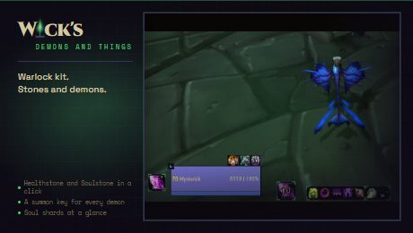

# Wick's Demons and Things

<!-- wick:badges:start -->

<!-- wick:badges:end -->

> Warlock bars for World of Warcraft: TBC Classic Anniversary. Stones and rituals, demons, cooldowns and procs, and your shard count.

Part of the **[Wick suite](https://github.com/Wicks-mods/WickSuite)**: precision addons built around a single fel-green-on-deep-purple aesthetic. Built on [WickCore](https://github.com/Wicks-mods/WickCore).

This is the TBC build, on the `tbc` branch. The Forever build lives on `main`.

## What it does

- **Soul bar.** Use a Healthstone or a Soulstone from your bags with one
  click, whichever rank you carry. Create Healthstone, Create Soulstone,
  Ritual of Summoning, Ritual of Souls and Eye of Kilrogg join it as you
  learn them.
- **Pet bar.** A summon button for each demon you know: Imp, Voidwalker,
  Succubus, Felhunter, and Felguard once talented. Soul Link and
  Sacrifice too. The demon that is out is lit up.
- **Cooldown bar.** Banish, Curse of Doom, Death Coil, Howl of Terror, Fel
  Domination, Conflagrate, Shadowfury and Soulshatter, each shown only if you
  know it, plus the Shadow Trance and Shadow Vulnerability procs for your
  spec. It rebuilds when you respec.
- **Shard counter.** A small badge with your soul shard count.

Every bar follows the look and theme you pick under Wick's Mods in the
game's Options. With Wick's UI loaded, move them with `/wui move`.

## Install

Requires **[WickCore](https://github.com/Wicks-mods/WickCore)**. Extract both
folders into `World of Warcraft\_anniversary_\Interface\AddOns\`.

## Usage

| Command | Effect |
|---|---|
| `/wdt` | Options panel |
| `/wdt soul` | Show or hide the soul bar |
| `/wdt pet` | Show or hide the pet bar |
| `/wdt cd` | Show or hide the cooldown bar |
| `/wdt shard` | Show or hide the shard counter |
| `/wdt lock` / `/wdt unlock` | Lock the bars in place, or let them be dragged |
| `/wdt reset` | Put every bar back where it started |
| `/wdt status` | Diagnostic info |

Each bar also has a key binding under Key Bindings, Wick's Demons and Things.

## More from Wick

<!-- wick:suite-table:start -->
| Addon | GitHub | CurseForge |
|---|---|---|
| **Wick's TBC BIS Tracker** | [repo](https://github.com/Wicks-mods/WickidsTBCBISTracker) | [CurseForge](https://www.curseforge.com/wow/addons/wicks-tbc-bis-tracker) |
| **Wick's CD Tracker** | [repo](https://github.com/Wicks-mods/WicksCDTracker) | [CurseForge](https://www.curseforge.com/wow/addons/wicks-cd-tracker) |
| **Wick's Trade Hall** | [repo](https://github.com/Wicks-mods/WicksTradeHall) | [CurseForge](https://www.curseforge.com/wow/addons/trade-hall) |
| **Wick's Macro Builder** | [repo](https://github.com/Wicks-mods/WicksMacroBuilder) | [CurseForge](https://www.curseforge.com/wow/addons/wicks-macro-builder) |
| **Wick's Combat Log** | [repo](https://github.com/Wicks-mods/WicksCombatLog) | [CurseForge](https://www.curseforge.com/wow/addons/wicks-combat-log) |
| **Wick's Stats** | [repo](https://github.com/Wicks-mods/WicksStats) | [CurseForge](https://www.curseforge.com/wow/addons/wicks-stats) |
| **Wick's Quest Key** | [repo](https://github.com/Wicks-mods/WicksQuestKey) | [CurseForge](https://www.curseforge.com/wow/addons/wicks-quest-key) |
| **Wick's Totems and Things** | [repo](https://github.com/Wicks-mods/WicksTotemsAndThings) | [CurseForge](https://www.curseforge.com/wow/addons/wicks-totems-and-things) |
| **Wick's Bags** | [repo](https://github.com/Wicks-mods/WicksBags) | [CurseForge](https://www.curseforge.com/wow/addons/wicks-bags) |
| **Wick's Travel Form** | [repo](https://github.com/Wicks-mods/WicksTravelForm) | [CurseForge](https://www.curseforge.com/wow/addons/wicks-travel-form) |
| **Wick's Ledger** | [repo](https://github.com/Wicks-mods/WicksLedger) | [CurseForge](https://www.curseforge.com/wow/addons/wicks-ledger) |
| **Wick's Wardrobe** | [repo](https://github.com/Wicks-mods/WicksWardrobe) | [CurseForge](https://www.curseforge.com/wow/addons/wicks-wardrobe) |
| **Wick's Survivors** | [repo](https://github.com/Wicks-mods/WicksSurvivors) | [CurseForge](https://www.curseforge.com/wow/addons/wicks-survivors) |
| **WickCore** | [repo](https://github.com/Wicks-mods/WickCore) | [CurseForge](https://www.curseforge.com/wow/addons/wickcore) |
| **Wick's Comforts** | [repo](https://github.com/Wicks-mods/WicksComforts) | [CurseForge](https://www.curseforge.com/wow/addons/wicks-comforts) |
| **Wick's Demons and Things** | [repo](https://github.com/Wicks-mods/WicksDemonsAndThings) | [CurseForge](https://www.curseforge.com/wow/addons/wicks-demons-and-things) |
| **Wick's UI** | [repo](https://github.com/Wicks-mods/WicksUIForever) | [CurseForge](https://www.curseforge.com/wow/addons/wicks-ui) |
| **Wick's Reminders** | [repo](https://github.com/Wicks-mods/WicksReminders) | [CurseForge](https://www.curseforge.com/wow/addons/wicks-reminders) |
| **Wick's Map** | [repo](https://github.com/Wicks-mods/WicksMap) | [CurseForge](https://www.curseforge.com/wow/addons/wicks-map) |

**Community:** [Discord](https://discord.gg/GWGTMhYBZY)
<!-- wick:suite-table:end -->

## License

Code is MIT. The Wick name, logomark and visual system are trademarks; see
[LICENSE](LICENSE).
